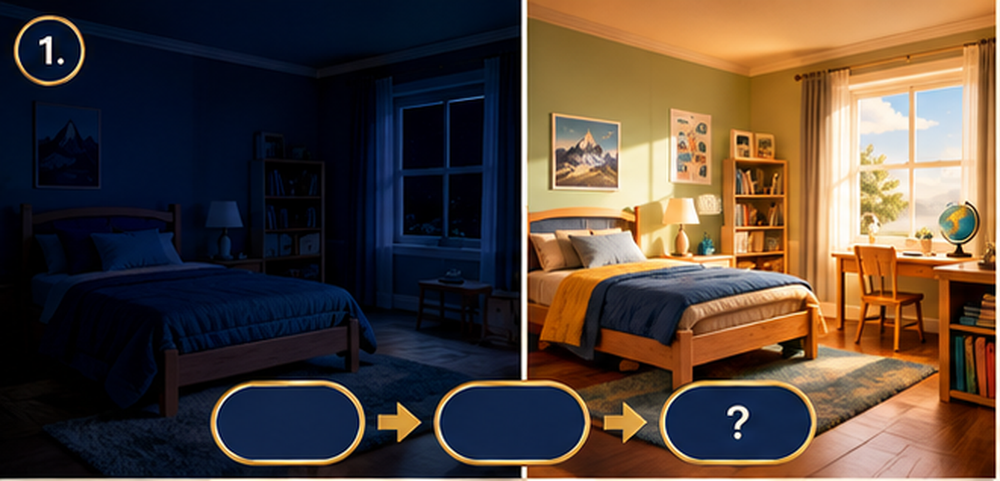
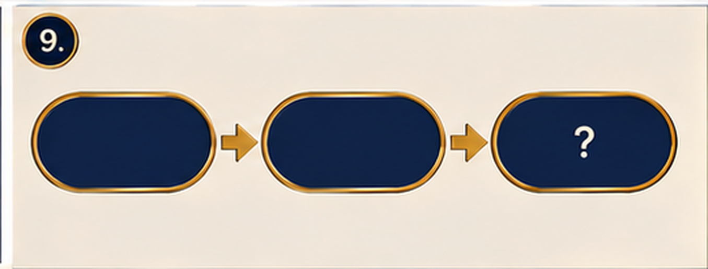
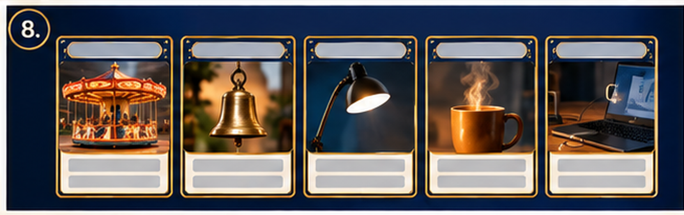
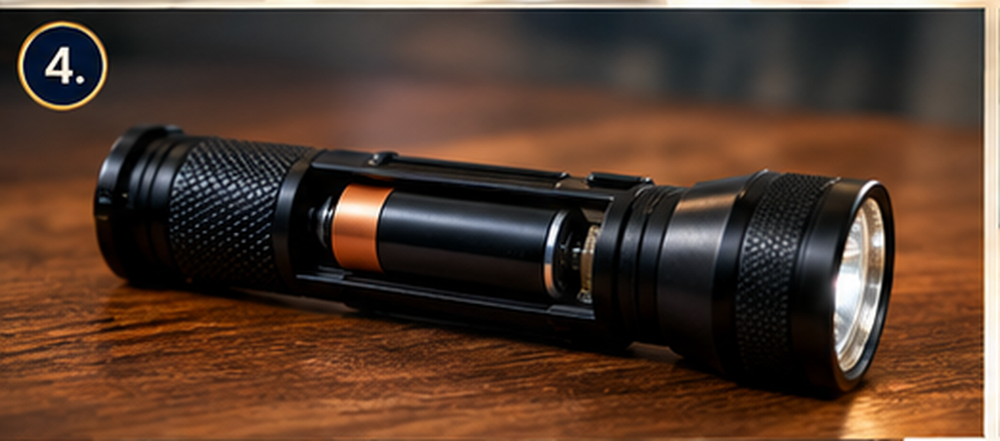
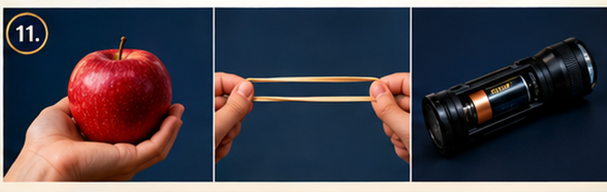
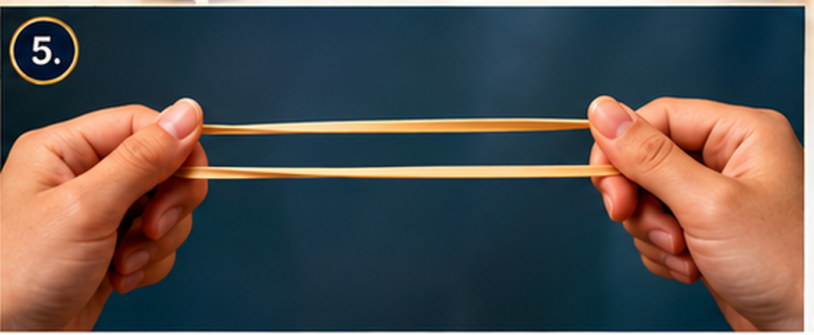
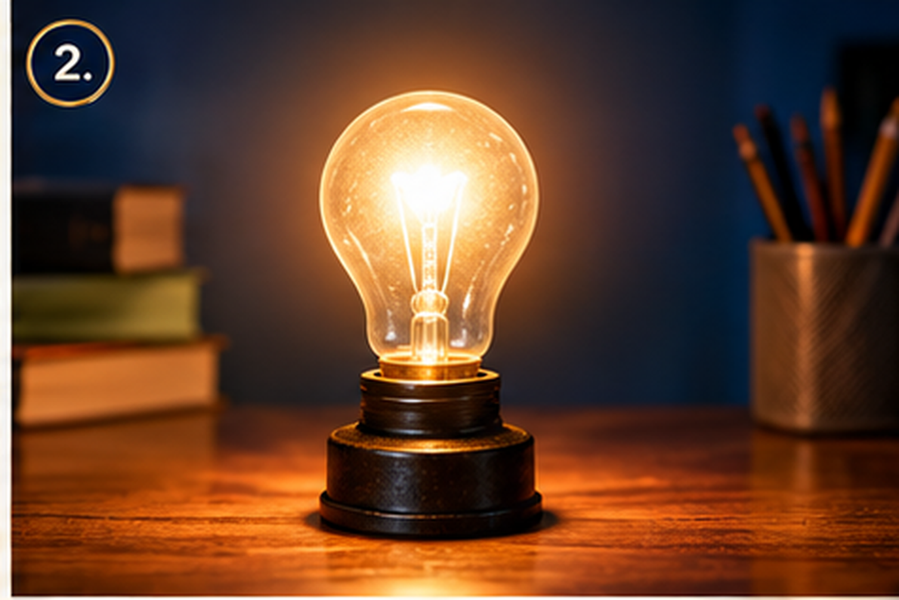

<!-- _class: lead -->

# Energy Causes Change

### Chapter 1 · Grade 4 Science

**Evidence tells the story.**

---

BQ · BIG QUESTION

# Where can we observe evidence of energy causing change?

**TURN & TALK:** Say the question in your own words.

---

BQ · MY FIRST THINKING

## What do you already think?

- **Energy is…** ______
- **A change I have seen is…** ______

*We come back to this at the end of the chapter.*

---DEMO · NOTICE &amp; WONDER

# What changed?

- The room was **dark**.
- Now the room is **bright**.

**THINK:** What changed? How do you know?

---

DEMO · NOTICE &amp; WONDER

## I notice… I wonder…

- **I notice:** ______
- **I wonder:** ______

---

D · DEMO — OBSERVE

# Watch the pencil sharpener

- **Look:** the pencil gets **shorter and sharper**.
- **Listen:** the sharpener is **quiet**, then **noisy**.
- **Think:** something caused these changes.

---

D · DEMO — PREDICT

## Predict first — then we test

**What will happen to the pencil?**

- The pencil will ______
- The sharpener will ______

---

D · DEMO — WHAT CHANGED?

## Before → After

| BEFORE | AFTER |
| --- | --- |
| long pencil | short pencil |
| quiet | noisy |

**What changed?** ______

---

D · CHANGES ARE CLUES

# Changes are clues

- We **cannot see** energy.
- We **can see** the change.
- So a change is a **clue** that energy was there.

**?** What are we still wondering?

---

V1 · VOCABULARY

# energy

> **Energy is the ability to cause change.**

*Reader p. 1*

**change**

> A **change** is something becoming different.

---

V1 · NOTES — WRITE

## Fill in your notes

- Energy is the ability to ______
- A change is something ______

*Write the words in your Guided Notes.*

---

V1 · REVEAL

# Check your words

- Energy is the ability to **cause change**.
- A change is something **becoming different**.

**TEACH:** change = different

---

N1 · ENERGY CAUSES CHANGE

# What is energy?

- Energy is the **ability to cause change**.
- We know energy is there because **something changed**.
- No change? Then we have **no evidence yet**.

---

N1 · MODEL IT

## Reader p. 2 — the seashore

- Waves move sand and rocks.
- That change is **evidence** of energy.

# ENERGY → CHANGE → ?

---N1 · NOTES — WRITE

## Complete the model

**ENERGY → CHANGE → ______**

- Write what the last box should be.
- Leave it blank if you are unsure.

---

N1 · REVEAL

# ENERGY → CHANGE → EVIDENCE

- **Evidence** is what we observe that shows what happened.
- The change is our **evidence**.

*Copy the word into your last box.*

---N2 · DIFFERENT FORMS

# Energy has different forms

- **motion** — moving objects have energy of motion
- **sound**
- **light**
- **heat**
- **electrical**

**THINK:** Which forms do you already know?

---

N2 · CHECK (OPTIONAL)

# Clap three times

**What forms of energy can you observe?**

- I hear ______
- I see my hands ______

---

N2 · NOTES — WRITE

## Write one example for each form

- motion: ______
- sound: ______
- light: ______
- heat: ______
- electrical: ______

---

V2 · VOCABULARY

# stored energy

> **Stored energy** can cause a change **later**.

*Reader p. 4*

---

V2 · NOTES — WRITE

## Fill in your notes

- Stored energy can cause a change ______

*Think: later, or never?*

---

V2 · REVEAL

# Stored energy can cause a change later

- It is **not always moving** right now.
- It is **waiting** to cause a change.

---

N3 · OBJECTS CAN STORE ENERGY

# Does a battery have energy if it is sitting still?

- **Predict:** yes or no?
- Give a reason.

*No answer yet — predict first.*

---N3 · STORED ENERGY OF POSITION

# Some stored energy comes from position

- A book on a **high shelf** can fall.
- A **raised object** can cause a change later.

**THINK:** Find 3 objects in this room with stored energy.

---N3 · MODEL IT

# STORED → RELEASE → CHANGE

- Battery in a flashlight → **stored** energy
- Turn it on → energy is **released**
- Light appears → a **change**

**Reader p. 4:** why do we replace batteries?

---N3 · NOTES — WRITE

## Complete the three examples

- battery: stored → ______ → light
- rubber band: stored → ______ → a snap
- raised object: stored → ______ → a fall

*Hint: position*

---

N3 · REVEAL

# Check your thinking

- **position** — where an object is
- battery → stored → **release** → change
- rubber band → stored → **release** → change
- raised object → stored (position) → **release** → change

---

N4 · RECOGNIZING EVIDENCE

# How do we know energy is at work?

- Look for a **change**.
- Ask: **what changed?**
- The change is the **evidence**.

---

N4 · NOTES — DRAW

## Draw BEFORE and AFTER

| BEFORE | AFTER |
| --- | --- |
|  |  |

**What changed?** ______

---

C · CHECK YOUR THINKING

# How do scientists know energy is involved if energy itself cannot be seen?

- Write **2 lines** in your notes.

---

C · REVEAL — SAMPLE

## A strong answer

> Scientists **look for a change**. The change is **evidence** that energy was involved, even though we cannot see energy itself.

---

P · APPLICATION (OPTIONAL)

# Which change shows energy at work?

- **A.** a pencil sits still on a desk
- **B.** a plant grows taller toward the window
- **C.** an empty cup on a shelf

**THINK:** Explain your choice.

---

BQ · NOW I THINK

# Where can we observe evidence of energy causing change?

- My first idea was ______
- Now I think ______

*Compare with your Slide 3 thinking.*

---

R · REVIEW Q1

# A plant grows taller toward a sunny window. This growth is best described as —

- **A.** a form of stored energy
- **B.** a kind of motion energy
- **C.** evidence of energy causing change
- **D.** a way energy disappears

**THINK:** signal A · B · C · D

---

R · Q1 ANSWER

## Answer: C

The growth is a **change**, and the change is **evidence** that energy was involved.

*B confuses a change with a stored form. D is wrong — energy does not disappear.*

---R · REVIEW Q2

# Which of these shows stored energy that can cause a change later?

- **A.** a stretched rubber band
- **B.** a ball rolling down a ramp
- **C.** a ringing bell
- **D.** a lit flashlight

**THINK:** signal A · B · C · D

---

R · Q2 ANSWER

## Answer: A

A stretched rubber band has **stored energy** that can snap back — a change — **later**.

---R · REVIEW Q3

# Look at the diagram: battery → wires → bulb → light. The **light** is —

- **A.** the energy that started
- **B.** the cause of the change
- **C.** a form of stored energy
- **D.** the change we can observe

**THINK:** signal A · B · C · D

---

R · Q3 ANSWER

## Answer: D

The light is the **observable change**. It is **evidence** that electrical energy was involved.

---

R · REVIEW Q4

# A student writes, "The cup of warm water cooled down." That is an example of —

- **A.** an explanation
- **B.** an observation
- **C.** a prediction
- **D.** a stored form of energy

**THINK:** signal A · B · C · D

---

R · Q4 ANSWER

## Answer: B

It states what was **seen** — an **observation**. "The heat moved out" would be an explanation.

---

R · REVIEW Q5

# Which best completes the chain?

**ENERGY → ______ → EVIDENCE**

- **A.** CHANGE
- **B.** LIGHT
- **C.** STORED
- **D.** MOTION

**THINK:** signal A · B · C · D

---

R · Q5 ANSWER

## Answer: A

Energy causes a **change**, and the change is the **evidence**.

---

R · REVIEW Q6

# A battery sits in a drawer and does not move. Which is TRUE?

- **A.** It has no energy because it is still.
- **B.** Its energy disappeared.
- **C.** It has **stored energy** that can cause a change later.
- **D.** It has energy only if it is warm.

**THINK:** signal A · B · C · D

---

R · Q6 ANSWER

## Answer: C

A still battery still has **stored energy**. Evidence appears only when it is placed in a device and the device **changes**.
